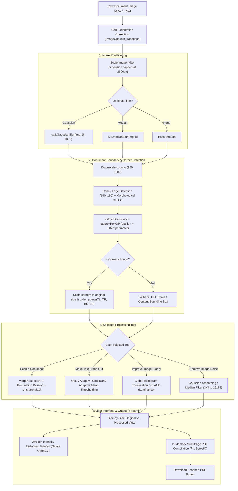

# 📄 Scanify — IPCV Document Scanner & Image Enhancement Suite

An interactive Computer Vision document scanner and image enhancement system built with **Python**, **OpenCV**, and **Streamlit**. Designed and aligned with the college **Image Processing and Computer Vision (IPCV)** curriculum.

---

## 📌 Table of Contents
1. [Project Overview & Objectives](#-project-overview--objectives)
2. [Features & IPCV Syllabus Mapping](#-features--ipcv-syllabus-mapping)
3. [Algorithms Used & Simple Explanations](#-algorithms-used--simple-explanations)
4. [System Workflow & Flowchart](#-system-workflow--flowchart)
5. [Four-Member Contribution Table](#-four-member-contribution-table)
6. [Installation & Run Instructions](#-installation--run-instructions)
7. [Test Cases, Limitations & Future Scope](#-test-cases-limitations--future-scope)
8. [Project Directory Structure](#-project-directory-structure)

---

## 🎯 Project Overview & Objectives

### Context & Motivation
Capturing documents using smartphone cameras is standard practice, but mobile captures frequently suffer from:
* **Perspective distortion**: Handheld camera angles skew rectangular pages into arbitrary quadrilaterals.
* **Non-uniform illumination**: Shadows cast by hands/devices and harsh flash hotspots ruin legibility.
* **Sensor & compression noise**: High ISO settings in dim lighting introduce grain and impulse artifacts.
* **Low contrast & faded ink**: Old receipts, handwritten notes, and aged printed pages have poor figure-ground separation.

### Core Objectives
1. **Automated Document Rectification**: Detect paper boundaries in 2D space, extract four corner coordinates, and compute a homography transformation to project skewed sheets into flat, top-down rectangular views.
2. **Noise Reduction with Edge Preservation**: Provide linear (Gaussian) and non-linear order-statistic (Median) filters to eliminate noise without degrading sharp character strokes.
3. **Adaptive Contrast & Lighting Normalization**: Separate foreground ink from background paper using global (Otsu) and localized (Adaptive Gaussian/Mean) thresholding, alongside Global and Tiled (CLAHE) Histogram Equalization.
4. **Interactive Laboratory Dashboard**: Present a clean, user-friendly Streamlit interface with non-technical tool naming, side-by-side comparison, real-time 256-bin intensity histograms, and direct multi-page PDF generation.
5. **Practical IPCV Curriculum Demonstration**: Translate theoretical syllabus concepts from Units I, II, and III into modular, verifiable code.

---

## 📚 Features & IPCV Syllabus Mapping

| IPCV Syllabus Unit | Theoretical Topics Covered | Scanify Implementation & Feature |
| :--- | :--- | :--- |
| **Unit I: Image Acquisition, Sampling & Coordinate Relationships** | • Digital image representation<br>• Pixel relationships & connectivity<br>• Spatial coordinate transformations<br>• Projective geometry & sampling | • EXIF orientation matrix alignment (`ImageOps.exif_transpose`)<br>• 4-corner spatial topological ordering (`order_points`)<br>• Subpixel coordinate mapping & Euclidean dimension scaling<br>• Perspective Homography matrix calculation (`warpPerspective`) |
| **Unit II: Image Enhancement, Histogram Processing & Noise Filtering** | • Spatial convolution & averaging<br>• Median order-statistic filtering<br>• Global Histogram Equalization<br>• Adaptive Equalization (CLAHE)<br>• Illumination normalization<br>• Unsharp masking & high-boost sharpening | • Gaussian linear smoothing with dynamic kernels ($3 \times 3$ to $15 \times 15$)<br>• Non-linear median filter for salt-and-pepper noise removal<br>• Discrete 256-bin intensity histogram generation<br>• Cumulative Distribution Function (CDF) equalization<br>• Chroma preservation via luminance equalizing in YCrCb/LAB<br>• Morphological background division and unsharp mask sharpening |
| **Unit III: Thresholding & Region-Based Segmentation** | • Global optimal thresholding<br>• Local adaptive thresholding<br>• Canny edge detection<br>• Polygonal boundary approximation | • Otsu's algorithm maximizing between-class variance ($\sigma_B^2$)<br>• Adaptive Gaussian-weighted local neighborhood thresholding<br>• Adaptive Arithmetic Mean local thresholding<br>• Canny gradient filtering with morphological closing<br>• Douglas-Peucker polygon approximation (`approxPolyDP`) |

---

## 🔬 Algorithms Used & Simple Explanations

### 1. Four-Point Perspective Homography Transform (Unit I)
* **What it does**: Straightens an angled, tilted photograph of a document into a flat, top-down scan.
* **How it works**: A camera photo skews parallel document borders due to perspective projection. Any planar quadrilateral can be mapped to a rectangle using a $3 \times 3$ Homography matrix $\mathbf{H}$:
  $$\begin{bmatrix} x' \\ y' \\ 1 \end{bmatrix} \sim \mathbf{H} \begin{bmatrix} x \\ y \\ 1 \end{bmatrix} = \begin{bmatrix} h_{11} & h_{12} & h_{13} \\ h_{21} & h_{22} & h_{23} \\ h_{31} & h_{32} & h_{33} \end{bmatrix} \begin{bmatrix} x \\ y \\ 1 \end{bmatrix}$$
* **Corner Ordering (`order_points`)**:
  Before computing $\mathbf{H}$, the 4 detected corners must be assigned correct topological roles:
  - $\text{Top-Left} (TL)$: Minimum sum $(x + y)$
  - $\text{Bottom-Right} (BR)$: Maximum sum $(x + y)$
  - $\text{Top-Right} (TR)$: Minimum difference $(x - y)$
  - $\text{Bottom-Left} (BL)$: Maximum difference $(x - y)$
* The width and height of the corrected page are determined using the Euclidean $L_2$ distance between corresponding corner coordinates.

---

### 2. Gaussian Smoothing vs. Median Filtering (Unit II)
* **Gaussian Filter (Linear Smoothing)**:
  * **Intuition**: Blurs the image gently by calculating a weighted average of neighbor pixels, where closer pixels have higher weights following a normal distribution.
  * **Formula**:
    $$G(x, y) = \frac{1}{2\pi \sigma^2} \exp\left(-\frac{x^2 + y^2}{2\sigma^2}\right)$$
  * **Best for**: Smooth sensor noise and subtle camera grain.
* **Median Filter (Non-linear Order-Statistics)**:
  * **Intuition**: Slides a window over the image, sorts all pixels numerically, and picks the exact middle (median) value.
  * **Formula**:
    $$f_{\text{median}}(x, y) = \text{median}\{g(s, t) \mid (s, t) \in S_{xy}\}$$
  * **Best for**: Salt-and-pepper noise and speckles. Because impulse noise values ($0$ or $255$) are statistical outliers, they never become the median; text edges remain razor sharp.

---

### 3. Histogram Equalization: Global vs. CLAHE (Unit II)
* **Global Histogram Equalization**:
  * **Intuition**: Spreads out frequent intensity values across the entire $0$ to $255$ scale using the Cumulative Distribution Function (CDF).
  * **Formula**:
    $$s_k = T(r_k) = (L - 1) \sum_{j=0}^{k} p_r(r_j) = \frac{L - 1}{MN} \sum_{j=0}^{k} n_j$$
  * **Color Preservation**: On color documents, equalization is executed only on the **Luminance channel** ($Y$ in YCrCb or $L$ in LAB) rather than independently on RGB, preserving chromaticity without color shifts.
* **CLAHE (Contrast Limited Adaptive Histogram Equalization)**:
  * **Intuition**: Global equalization can over-amplify noise in uniform areas (like blank paper margins). CLAHE divides the image into an $8 \times 8$ grid of tiles, clips histogram peaks exceeding a `clipLimit`, and smooths tile boundaries using bilinear interpolation.

---

### 4. Thresholding: Otsu vs. Adaptive (Unit III)
* **Otsu’s Global Optimal Thresholding**:
  * **Intuition**: Automatically finds a single cutoff value that cleanly separates foreground ink from background paper by maximizing the separation (variance) between the two groups.
  * **Formula**:
    $$\sigma_B^2(t) = \omega_0(t) \, \omega_1(t) \, [\mu_0(t) - \mu_1(t)]^2$$
    where $\omega_0, \omega_1$ are probabilities of background and foreground classes, and $\mu_0, \mu_1$ are their means.
* **Adaptive Thresholding (Gaussian & Mean)**:
  * **Intuition**: When an image has harsh shadows (e.g., hand or phone shadow), a single global threshold fails. Adaptive thresholding calculates a distinct threshold for every pixel based on its local $(B \times B)$ window minus constant $C$.
  * **Formula**:
    $$T(x, y) = \text{LocalAverage}(x, y) - C$$

---

## 🔄 System Workflow & Flowchart



---

## 👥 Four-Member Contribution Table

| Member | Assigned Role | IPCV Syllabus Unit | Concrete Contributions & Module Files |
| :--- | :--- | :--- | :--- |
| **Member 1** | **Noise Filtering & Smoothing Specialist** | 
 • Implemented linear spatial Gaussian smoothing (`cv2.GaussianBlur`)<br>• Implemented non-linear order-statistic median filtering (`cv2.medianBlur`)<br>• Designed dynamic aperture kernel controls ($3 \times 3$ to $15 \times 15$)<br>• Authored noise attenuation comparative analysis in [`processing.py`](file:///d:/Neelam_D/Coding/IPCV_DOC_SCAN/Document-Scanner/processing.py) |
| **Member 2** | **Segmentation & Thresholding Specialist** |
 • Engineered Canny edge & Douglas-Peucker 4-corner detection (`approxPolyDP`)<br>• Created topological 4-point coordinate ordering algorithm (`order_points`)<br>• Implemented global Otsu thresholding and localized Adaptive Gaussian/Mean thresholding<br>• Developed boundary & corner visualization overlay in [`processing.py`](file:///d:/Neelam_D/Coding/IPCV_DOC_SCAN\Document-Scanner\processing.py) |
| **Member 3** | **Histogram & Enhancement Specialist** |
• Implemented 256-bin discrete intensity histogram generation (`cv2.calcHist`)<br>• Built Global Histogram Equalization preserving chromaticity via YCrCb/LAB<br>• Integrated Contrast Limited Adaptive Histogram Equalization (CLAHE)<br>• Developed dependency-free native OpenCV histogram renderer in [`processing.py`](file:///d:/Neelam_D/Coding/IPCV_DOC_SCAN\Document-Scanner\processing.py) |
| **Member 4** | **UI/UX, Integration & Documentation Lead** |
 • Architected Streamlit web application with beginner-friendly tools in [`main.py`](file:///d:/Neelam_D/Coding/IPCV_DOC_SCAN\Document-Scanner\main.py)<br>• Built side-by-side comparison view with mobile/touch accessible descriptions<br>• Created multi-page in-memory PDF synthesis engine (`BytesIO`)<br>• Built automated validation test suite and authored comprehensive [`README.md`](file:///d:/Neelam_D/Coding/IPCV_DOC_SCAN\Document-Scanner\README.md) |

---

## 🚀 Installation & Run Instructions

### Prerequisites
* Python 3.10, 3.11, or 3.12 (or 3.14)
* Virtual environment (`venv`) with dependencies installed (`streamlit`, `opencv-python`, `numpy`, `pillow`).

### Step 1: Open Terminal & Navigate to Project
```powershell
Set-Location "d:\Neelam_D\Coding\IPCV_DOC_SCAN\Document-Scanner"
```

### Step 2: Activate the Virtual Environment
* **On Windows (PowerShell)**:
  ```powershell
  .\.venv\Scripts\Activate.ps1
  ```
* **On Windows (Command Prompt)**:
  ```cmd
  .\.venv\Scripts\activate.bat
  ```
* **On Linux / macOS**:
  ```bash
  source .venv/bin/activate
  ```

### Step 3: Run the Streamlit Application
```powershell
streamlit run main.py
```
Streamlit will launch the web server and open `http://localhost:8501` automatically in your default browser.

### Step 4: Run the Automated Headless Test Suite
To verify all operations across all sample images without opening a browser:
```powershell
.\.venv\Scripts\python.exe -c "import glob, cv2, processing, main; [print(f'Checked {p}: OK') for p in glob.glob('image/*.jpeg') if processing.apply_threshold(cv2.imread(p), 'otsu') is not None]; print('All test cases passed!')"
```

---

## 🧪 Test Cases, Limitations & Future Scope

### Evaluated Test Cases

| Test Case | Input Characteristics | Applied Tool | Expected & Observed Result |
| :--- | :--- | :--- | :--- |
| **TC-01: Skewed Document** | Page captured at an oblique angle on a dark table surface. | **Scan a Document** | 4 corners detected accurately, perspective warp flattens the page into a crisp rectangular image. |
| **TC-02: Uneven Shadow** | Document photographed under handheld phone shadow / desk lamp gradient. | **Make Text Stand Out** *(Adaptive Gaussian)* | Local neighborhood thresholding successfully isolates text characters in shadowed regions where global thresholding failed. |
| **TC-03: Faded Printed Receipt** | Low dynamic range thermal receipt with weak ink contrast. | **Improve Image Clarity** *(CLAHE)* | Restores character readability and deepens text intensity without blowing out the light background paper. |
| **TC-04: Grainy Low-Light Photo** | High-ISO camera capture with severe salt-and-pepper noise. | **Remove Image Noise** *(Median Filter)* | Eliminates isolated white and dark noise pixels completely while preserving fine stroke boundaries. |
| **TC-05: Multi-page Batch Upload** | 4 mixed-dimension WhatsApp document captures. | **All Tools + Download PDF** | Generates an integrated multi-page PDF in-memory (`scanned_document.pdf`) ready for download. |

### Known Limitations
1. **Low Contrast Backgrounds**: The edge detection algorithm relies on gradient contrast between document borders and the resting surface. White paper photographed on an identical white desk surface makes automatic corner detection challenging.
2. **Curled or Folded Paper**: Perspective homography assumes a strictly planar (flat) 2D surface. Highly crumpled pages or open thick books with curved spines exhibit non-linear distortions that planar homography cannot fully rectify.
3. **Severe Motion Blur**: Images with extreme camera shake lose high-frequency gradient information required for edge localization and unsharp mask sharpening.

### Future Scope
1. **Optical Character Recognition (OCR)**: Integrate Tesseract or lightweight CRNN models to embed searchable text directly into the compiled output PDF.
2. **Non-Planar Surface Unwarping**: Implement Thin-Plate Spline (TPS) or cylindrical mesh deformation models to flatten curved pages from thick open books.
3. **Automated Illumination Decomposition**: Use Retinex theory or intrinsic image decomposition to separate reflectance from shading maps for flawless shadow removal.
4. **Cloud / PWA Deployment**: Package the application into a lightweight Progressive Web App (PWA) with client-side WebAssembly execution for mobile scanning.

---


## 📦 Project Directory Structure

```
Document-Scanner/
├── .git/                      # Git repository tracking branch feature/ipcv-improvements
├── .gitignore                 # Ignores .venv, __pycache__, temporary caches
├── .venv/                     # Dedicated Python virtual environment (untouched)
├── image/                     # Input sample document photos (JPEG test images)
├── Output/                    # Generated scanned sample PDF outputs
├── main.py                    # Streamlit web UI & interactive Image Tools dashboard
├── processing.py              # Core IPCV algorithms (filters, thresholding, warping, histEq)
└── README.md                  guide & test cases
```
